# GuardRail

**A mini SIEM (security monitoring dashboard) for my two live websites, [HomeHaat](https://homehaat.vercel.app) and
[Oppora](https://oppora-app.vercel.app). They send HMAC-signed security events; GuardRail runs six detection rules
mapped to MITRE ATT&CK, raises alerts, emails me about the serious ones and shows everything live.**

**Live: <https://guardrail-rasmitha.vercel.app>** · **Try the read-only demo: <https://guardrail-rasmitha.vercel.app/demo>**

> The dashboard itself has exactly one account (mine, with 2FA). The **demo** shows the same pages with made-up data,
> clearly labelled, and can't change anything.

## Explainer video (60 s)

[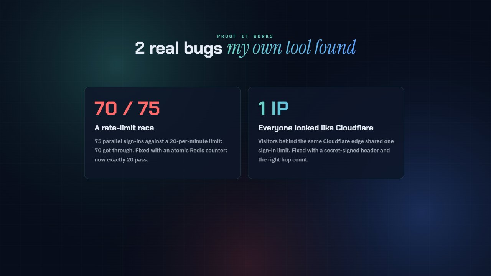](https://youtu.be/-Kf0gWaKzsk)

**[▶ Watch on YouTube](https://youtu.be/-Kf0gWaKzsk)** (or [download the MP4](docs/demo/guardrail-explainer.mp4))

A one-minute explainer: the attacks live sites face, how signed events become alerts, the six MITRE ATT&CK rules, the
two real bugs GuardRail found, privacy, and what it's built with. Drawn on a canvas and encoded in Chrome
([`docs/demo/maker/`](docs/demo/maker/)), with original background music.

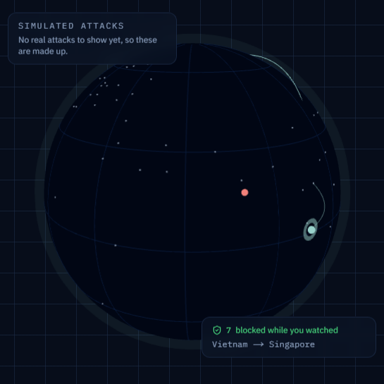

## Screenshots

All screenshots use the demo's made-up data (IP addresses from the ranges reserved for documentation, masked
`example.com` accounts).

| | |
|---|---|
| 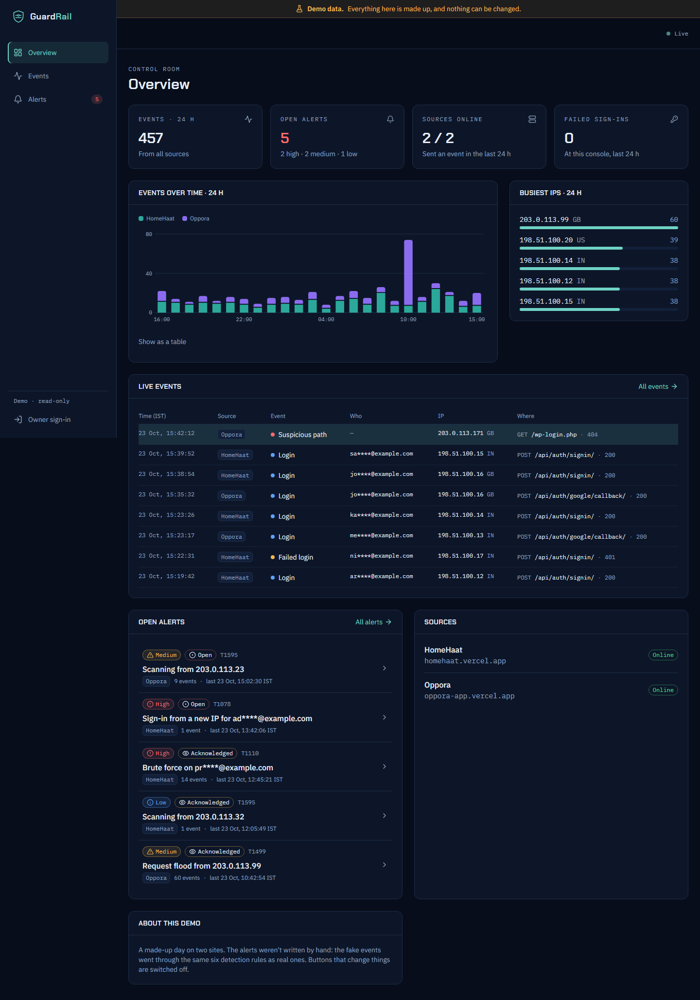 **Overview**: events per hour (stacked by site), busiest IPs, live feed, open alerts | 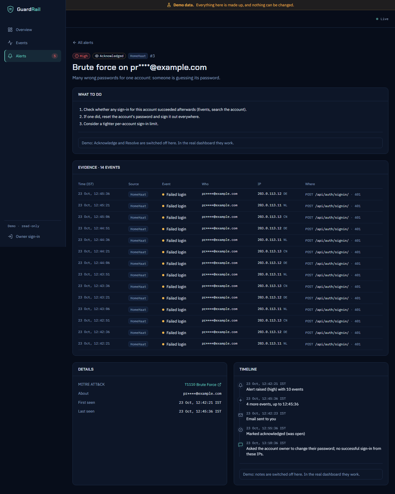 **Incident**: what to do, the evidence, MITRE ATT&CK link, timeline with notes |
| 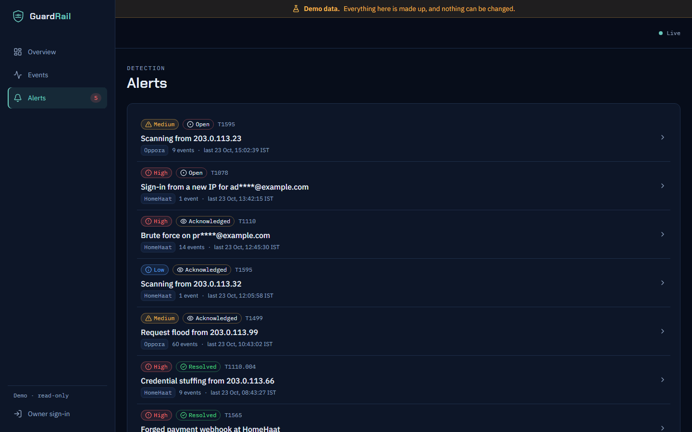 **Alerts**: one alert per attack, severity, status | 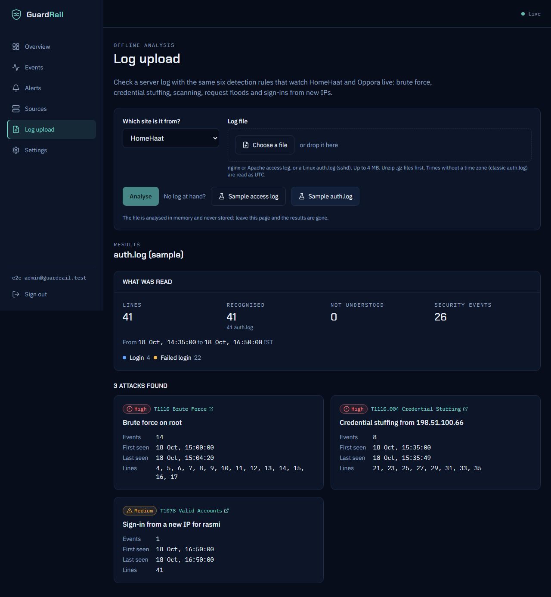 **Log upload**: an nginx/Apache or sshd log checked with the same rules, never stored |
| 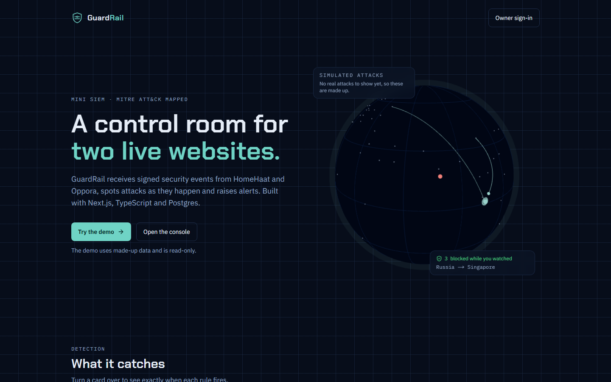 **Home page** with the 3D globe | 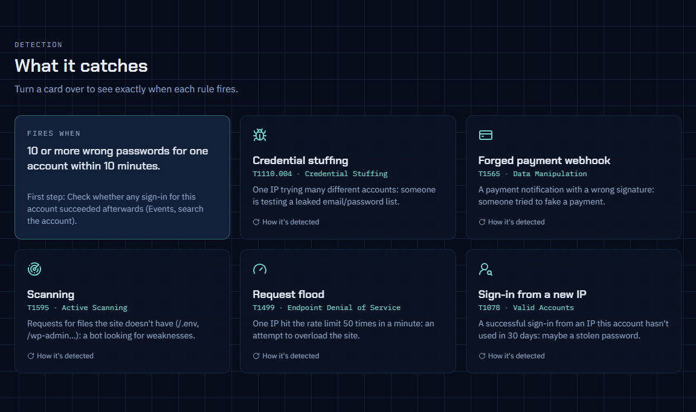 **What it catches**: each card turns over to show when the rule fires |

  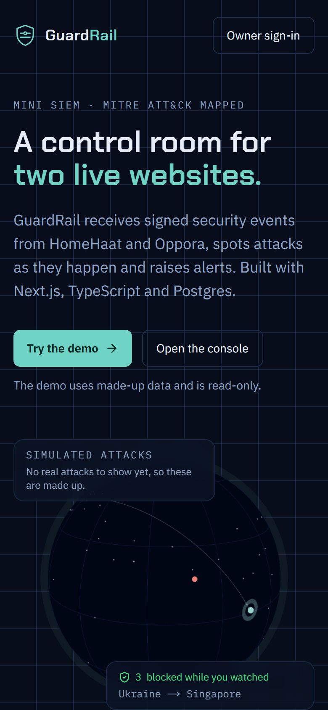
  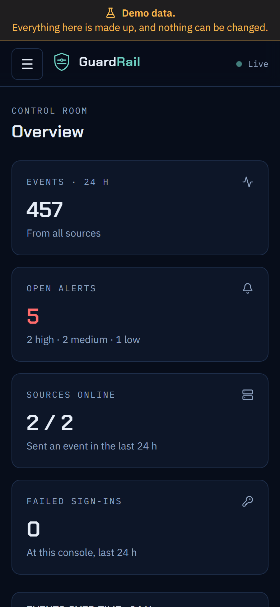
  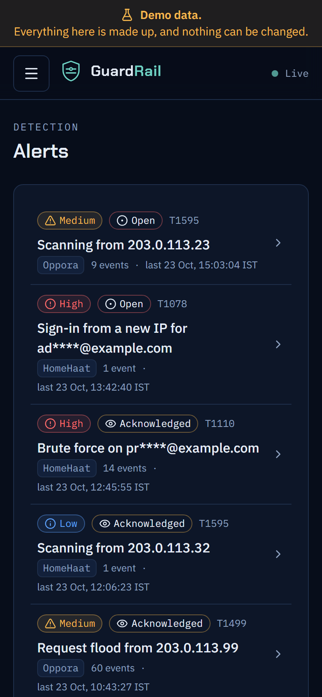

## What it does

- **Collects signed events** from HomeHaat (Django on Render) and Oppora (Django on Render): failed and successful
  sign-ins, admin sign-ins, rate-limit hits, scanner paths (`/.env`, `/wp-admin`…), forged payment webhooks, refunds,
  403s. Each site signs every batch with its own secret; forged or replayed requests are refused.
- **Detects attacks** with six rules, each a MITRE ATT&CK technique:

  | Rule | MITRE | Fires when |
  |---|---|---|
  | Brute force | T1110 | 10+ wrong passwords for one account in 10 minutes |
  | Credential stuffing | T1110.004 | one IP fails on 5+ different accounts in 10 minutes |
  | Forged payment webhook | T1565 | any payment notification with a wrong signature |
  | Scanning | T1595 | requests for scanner paths (medium at 5+ in 5 minutes) |
  | Request flood | T1499 | one IP hits the rate limit 50 times in a minute |
  | Sign-in from a new IP | T1078 | a sign-in from an IP the account hasn't used in 30 days (high for admins) |

- **Raises one alert per attack** (not one per event), with evidence, plain advice, a status flow
  (open → acknowledged → resolved), notes and an incident timeline. High alerts send one email (Resend).
- **Shows it live**: Server-Sent Events push new events to the dashboard within ~2 seconds, on free serverless hosting.
- **Analyses uploaded logs** (nginx/Apache access logs, Linux `auth.log`) with the same rules, entirely in memory.
- **A public home page** with a 3D globe of attack origins (countries only) and a **public read-only demo**.

## Web development highlights

- **Next.js 16 App Router + TypeScript (strict)**, server components by default; client components only where the
  page is interactive (live lists, charts, the globe, forms). One shared view per page (`components/views/`) renders
  both the real dashboard and the demo.
- **Real-time on serverless without WebSockets.** Each Server-Sent Events stream polls Postgres by a cursor every
  2 s and closes after ~50 s; the browser reconnects with `Last-Event-ID`, so nothing is missed or doubled. One
  connection per tab, a polling fallback, and it pauses while the tab is hidden.
  ([`app/api/stream/route.ts`](app/api/stream/route.ts), [`components/live/LiveProvider.tsx`](components/live/LiveProvider.tsx))
- **Detection after the response.** Ingest stores events and answers `202` first; the rules run in Next.js
  `after()`, so the sites' 2-second timeout never includes detection or email.
  ([`lib/detection/engine.ts`](lib/detection/engine.ts))
- **3D globe that's cheap and accessible**: React Three Fiber, downloaded only when it will be used, paused when off
  screen, one Three.js layer animates every arc without React re-renders, a still SVG for reduced motion or no
  WebGL. ([`components/landing/`](components/landing/))
- **Charts without a chart library**: hand-drawn SVG with a keyboard tooltip and a "Show as a table" view, colours
  checked for colour-blind readers. ([`components/charts/EventsChart.tsx`](components/charts/EventsChart.tsx))
- **Pure, tested core logic**: detection rules, log parsers, TOTP, rate-limit windows, chart buckets, retention
  cut-offs and the demo generator are pure functions with unit tests; the database code stays thin.
- **Typed end to end**: Zod validates every request body and every setting at startup; one typed `apiFetch` is the
  only place the browser calls the API; Drizzle ORM gives typed SQL.
- **Designed for phones and keyboards**: 44 px touch targets, one focus ring, a skip link, a `<dialog>` menu,
  `aria-live` for new events, and loading / empty / error states on every page.

## Security highlights

- **Signed, replay-proof ingest.** HMAC-SHA256 over `timestamp:nonce:raw body` with a per-site secret, compared in
  constant time; a ±5-minute window; each nonce is a primary key, so a captured request works exactly once, even
  under concurrency. Every failure gives the same `401`. ([`lib/ingest/signature.ts`](lib/ingest/signature.ts))
- **Exactly-once events.** Senders retry until they get an answer (at-least-once); each event carries an id and
  `UNIQUE (source, uid)` stores it once. Found by testing: a slow first answer made HomeHaat retry a saved batch.
- **One alert per attack, safely under concurrency**: a partial unique index (`UNIQUE (group_key) WHERE status <>
  'resolved'`) plus `ON CONFLICT DO NOTHING` and `SELECT … FOR UPDATE`. ([`lib/alerts/store.ts`](lib/alerts/store.ts))
- **One account, strong sign-in**: Argon2id passwords (with dummy hashing for unknown emails), TOTP 2FA written from
  the RFC and tested against its vectors, codes usable once, the 2FA secret encrypted with AES-256-GCM, session
  tokens stored only as SHA-256 and replaced after 2FA, a sliding per-IP and per-account sign-in limit.
- **Browser protections**: a per-request CSP nonce (`'strict-dynamic'`), an `Origin` check on every POST (CSRF),
  `httpOnly` `__Host-` cookies, HSTS, no framing.
- **Privacy by design**: emails masked at the sender and again on the server (a keyed hash tells accounts apart),
  query strings (tokens) cut from paths, a `meta` allow-list, raw IPs wiped after 30 days by a daily cron while a
  keyed hash keeps the statistics working, alert emails without IPs, uploaded logs never stored, and the public
  globe sees only country totals with at least 3 events per country.
- **Monitoring that can't hurt the sites**: the senders queue events in memory and send them from a background thread
  with a 2-second timeout; if GuardRail is down, events wait in an outbox table and are retried. There's an off
  switch, and tests prove sign-in works the same with GuardRail down.
- **Safe testing**: the attack simulator only attacks `localhost` (checked by parsing the URL, so
  `localhost@evil.com` is refused) and uses documentation-only IP ranges; tests that delete data refuse any database
  except the local throwaway one.

## Two real bugs GuardRail found

**A race condition in Oppora's rate limiter.** My attack simulator sent 75 sign-in requests to a local Oppora, 8 at
a time, against a limit of 20 a minute. **70 got through.** Django REST Framework's throttle reads the request
history from Redis and writes it back in two separate steps, so requests arriving together all read the same old
history (check-then-act). The fix is an atomic counter (Redis `ADD` + `INCR`): now exactly 20 pass and 55 are
blocked, with a regression test that fires the requests in parallel.

**Every Oppora visitor looked like Cloudflare.** After going live, an alert showed the IP `172.69.131.168`, a
Cloudflare address. On Render each request passes through Cloudflare and Render's relay (and Vercel, from the
website), and Oppora counted the wrong number of hops back in `X-Forwarded-For`. So visitors behind the same
Cloudflare data centre **shared one sign-in limit**. I measured the real chain with fake documentation addresses in
the header, then fixed it: the website passes the visitor's IP with a shared secret (Django trusts it only with the
secret), and requests straight to Render count back to the address Cloudflare itself wrote, which can't be faked.
HomeHaat got the same fix for requests that skip its website.

## Architecture

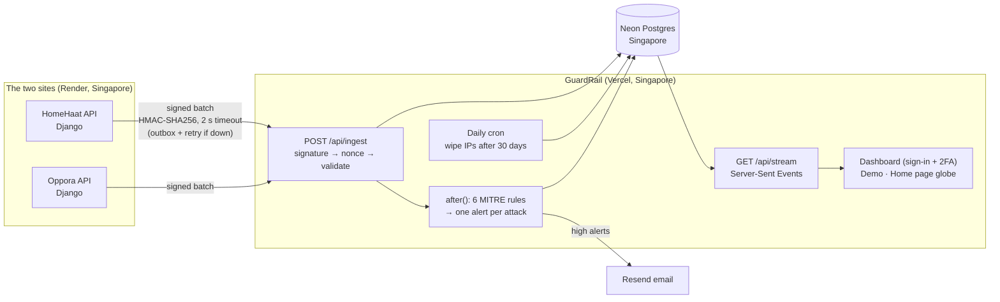

## Tech stack

| Part | Choice |
|---|---|
| App | Next.js 16 (App Router, `proxy.ts`, `after()`), React 19, TypeScript strict |
| Styling | Tailwind CSS v4 with design tokens; Chakra Petch, IBM Plex Sans / Mono |
| 3D | Three.js + React Three Fiber |
| Database | PostgreSQL 17 (Neon in production, Docker locally), Drizzle ORM + migrations |
| Validation | Zod (requests, events, settings) |
| Auth | Argon2id (`@node-rs/argon2`), own TOTP (RFC 6238), AES-256-GCM, `qrcode` |
| Email | Resend HTTP API (no SDK) |
| Tests | Vitest (147 unit tests), Playwright (35 end-to-end tests) |
| Hosting | Vercel Hobby (functions in Singapore, daily cron), Neon free plan |
| The senders | Python in each Django site: a background-thread client with an outbox table |

## Run it locally

You need Docker Desktop and Node.js 22+ on Windows.

1. Clone the repository.
2. Double-click **`Start GuardRail.bat`** (or run `.\start-guardrail.ps1`). It starts PostgreSQL in Docker, creates
   `.env` with random local keys, installs packages, runs migrations and opens the app on <http://localhost:3100>.
3. `npm run admin:create` to make your account, then sign in and set up 2FA.
4. To see it work: run HomeHaat or Oppora locally, `npm run connect:homehaat` (or `connect:oppora`) once, then
   `npm run simulate` (attacks your **local** copy only) and watch /dashboard.

Tests: `npm run check` (lint + types + unit tests) and `npm run test:e2e` (Playwright on a separate throwaway
database). Putting it online for free: [docs/deploy.md](docs/deploy.md).

The plain-English explanation of every key piece ("How it works", with interview notes) is in [`CLAUDE.md`](CLAUDE.md).

## How it was built

I built GuardRail with [Claude Code](https://claude.com/claude-code) as my AI pair-programmer: I set the brief, the
design direction and the rules (free plans only, real data only in the real dashboard, never paste secrets into
chat, tests for every key piece of logic, never slow down or break the live sites), made the decisions at each stage,
did the dashboard setup myself, and reviewed and tested the results.
